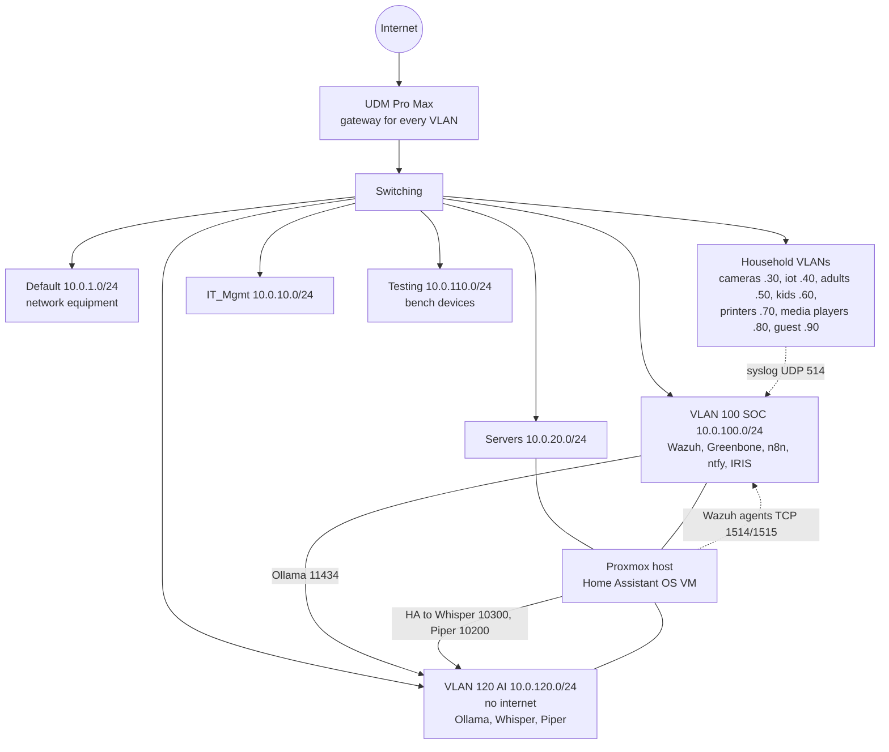

# Network overview (lab addressing)

All addresses and VLAN IDs are placeholders from the plan. Real values stay in the private repo.

## Data flow in one line

Endpoints and network devices send logs to Wazuh. Wazuh and Greenbone raise alerts. n8n asks a local LLM to summarize them, then waits for a phone approval on ntfy before it acts.
